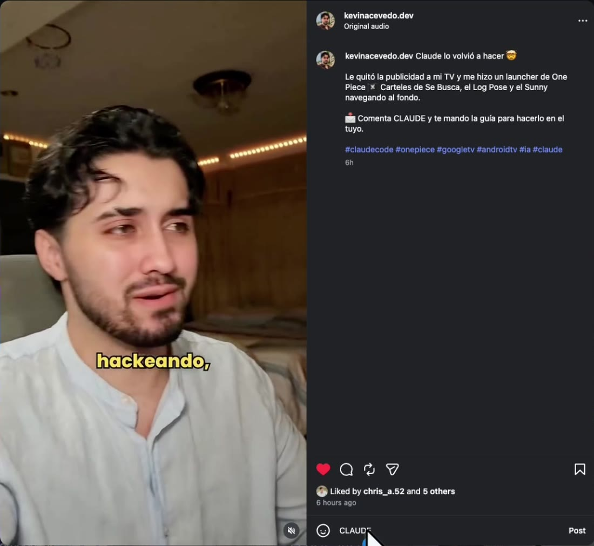
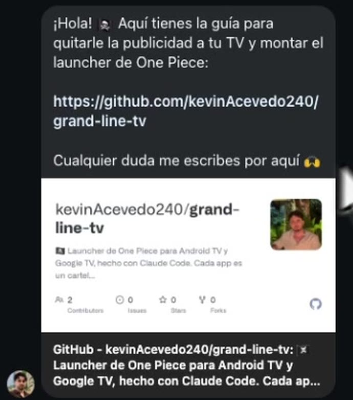
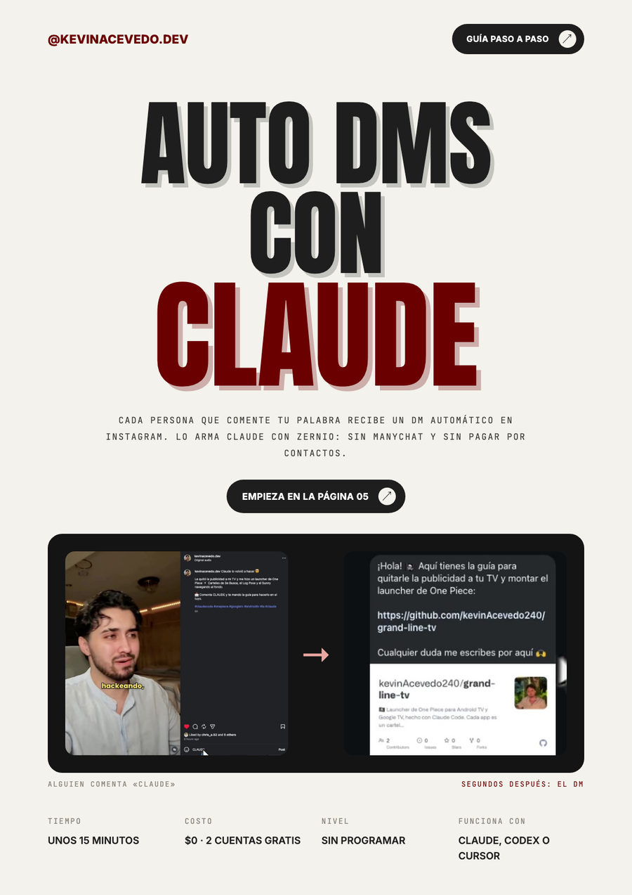
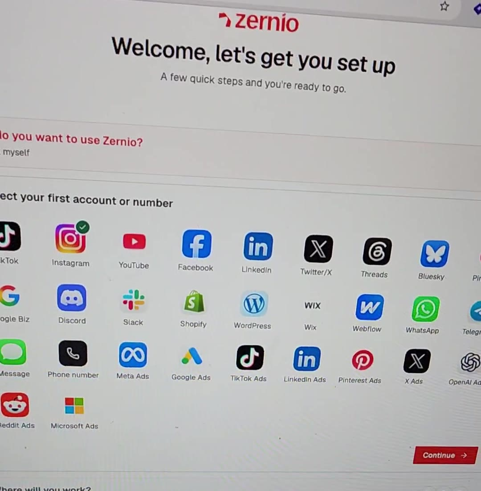
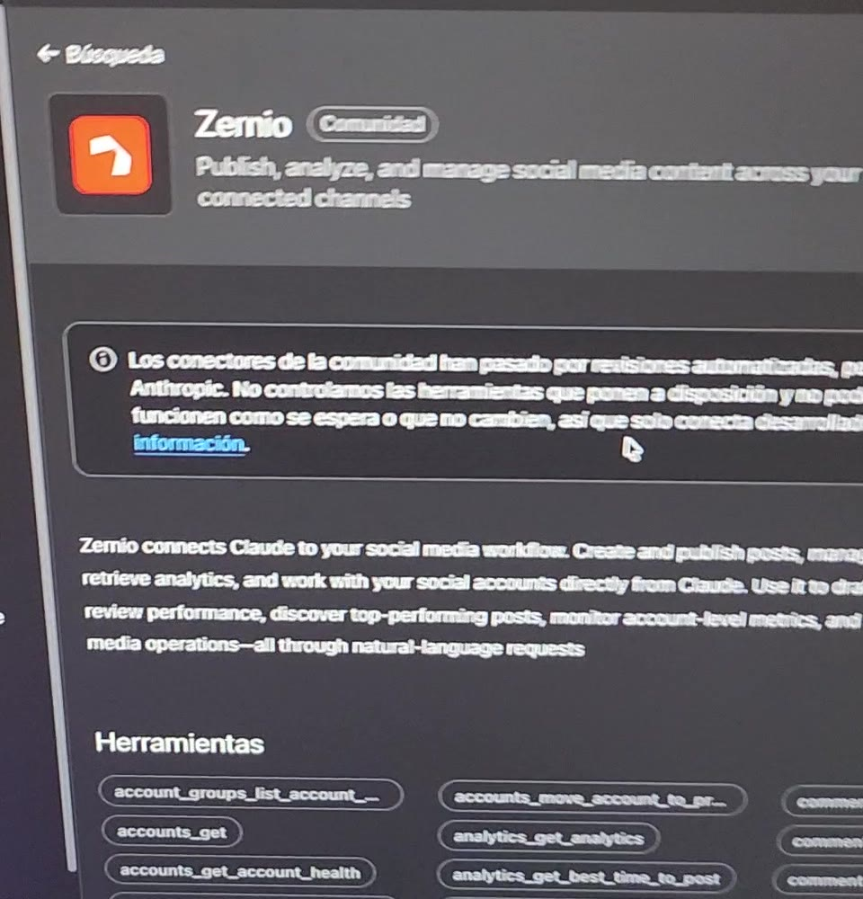
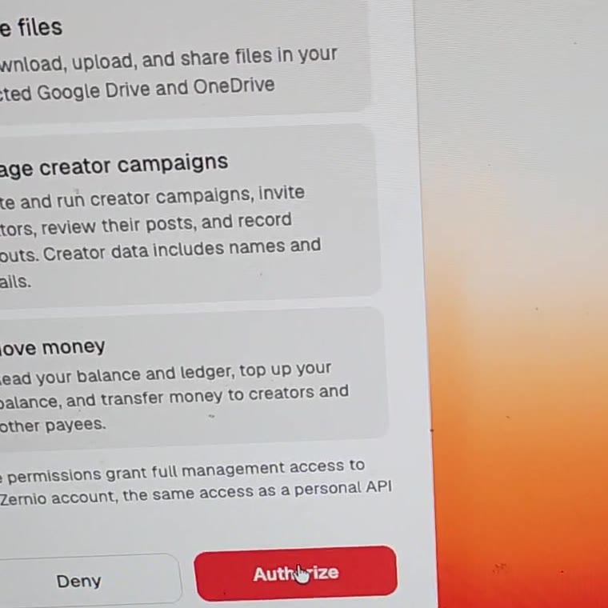
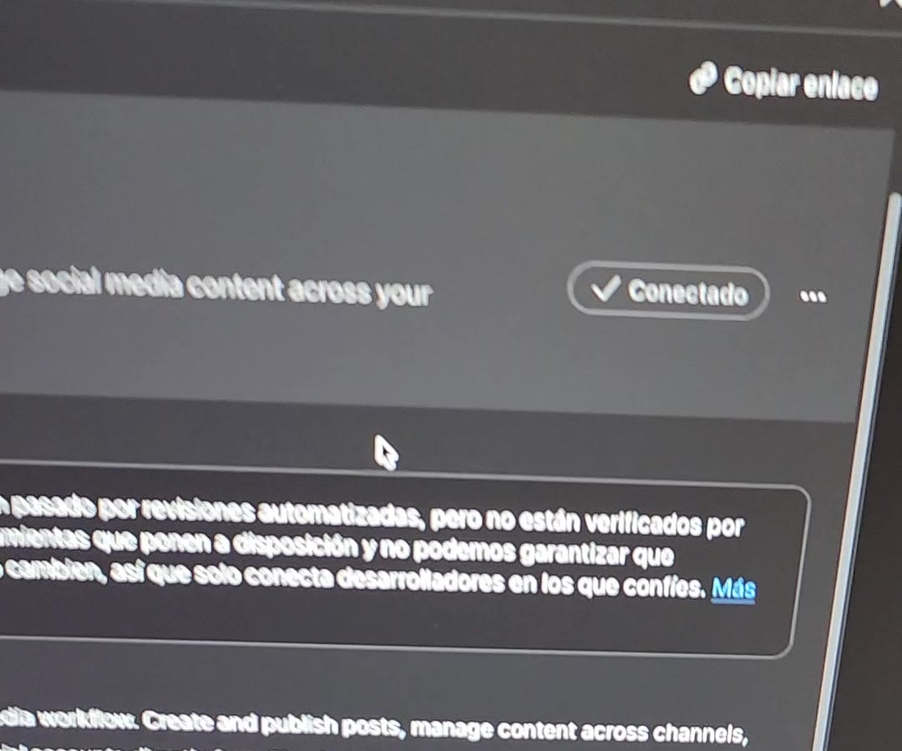
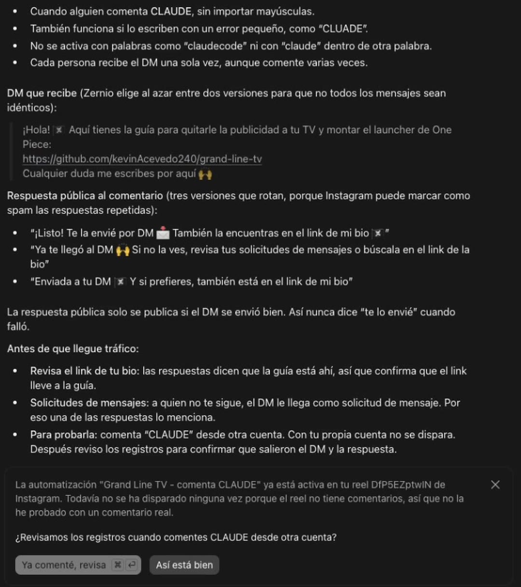

# Auto DMs con Claude 💬 · Comentan tu palabra y les llega el DM

Cada persona que comenta tu palabra clave en Instagram recibe un DM automático con tu link, como en ManyChat. La diferencia es que aquí la automatización la arma **Claude** con **[Zernio](https://zernio.com)**: no armas flujos ni pagas por contactos.

| Alguien comenta «CLAUDE» | Segundos después: el DM |
|---|---|
|  |  |

- ⏱️ **Unos 15 minutos**
- 💸 **$0**: las 2 primeras cuentas y 10.000 mensajes al mes son gratis en Zernio
- 🧑‍💻 **Sin programar**
- 🤖 **Funciona con** Claude (web, escritorio o celular), Claude Code, Codex, Cursor o cualquier IA con MCP

<a href="Guia-Auto-DM-Claude.pdf"></a>

📄 **[Descarga la guía visual en PDF](Guia-Auto-DM-Claude.pdf)**, con capturas de cada paso.

---

## ¿Funciona en mi red?

| Red | Qué hace | Qué necesitas |
|---|---|---|
| **Instagram** | ✅ DM + respuesta pública | Cuenta **profesional** (Creador o Empresa). Sirve en posts, reels, historias y lives. |
| **Facebook** | ✅ DM + respuesta pública | Una **Página** de Facebook. Con un perfil personal no se puede. |
| **TikTok** | ⚠️ Solo respuesta pública | TikTok no deja mandar DMs automáticos. Ver [TikTok](#tiktok-y-las-demás-redes). |
| **Threads, YouTube, LinkedIn** | ⚠️ Solo respuesta pública | Igual que TikTok. |

## Qué necesitas

1. **Tu Instagram en modo profesional**, de Creador o Empresa. Si es personal, la cambias en el paso 1.
2. **Una cuenta de [Zernio](https://zernio.com)**. Es gratis y no pide tarjeta. Funciona como puente: tu IA le da las órdenes y Zernio habla con Instagram.
3. **Una IA con conectores (MCP)**: Claude, Claude Code, Codex o Cursor.
4. **El link del post** y **la palabra** que la gente va a comentar (por ejemplo, `GUIA`).
5. **Lo que vas a enviar por DM**: tu mensaje con el link.

---

## Paso a paso

### 1. Pasa tu Instagram a profesional · 1 min

En la app de Instagram, ve a **Tu perfil › ☰ Menú › Tipo de cuenta y herramientas › Cambiar a cuenta profesional** y escoge **Creador** o **Empresa**. Las dos sirven. Es gratis, no pierdes seguidores y puedes volver a personal cuando quieras.

Después activa el permiso de mensajes en **☰ Menú › Mensajes y respuestas a historias › Herramientas conectadas › Permitir acceso a los mensajes**.

> 💡 Si no ves esa opción, usa la lupa de Configuración y busca «Herramientas conectadas». El nombre cambia un poco según la versión de la app.

### 2. Crea tu cuenta de Zernio y conecta Instagram · 3 min

1. Entra a **[zernio.com](https://zernio.com)** y crea tu cuenta con Google, GitHub o tu correo.
2. En **«Connect your first account»**, toca **Instagram**, inicia sesión y dale **Permitir**.
3. Si también usas TikTok, conéctalo aquí mismo: es tu segunda cuenta gratis.



> Con el inicio de sesión normal de Instagram **no necesitas página de Facebook**.

### 3. Conecta Zernio a tu IA · 2 min

**En Claude** (web, escritorio o celular): **Personalizar › Conectores**, busca **Zernio**, dale **Conectar** y luego **Authorize** en la ventana de Zernio.

| Buscar y conectar | Autorizar en Zernio | Conectado |
|---|---|---|
|  |  |  |

Si no te aparece en la lista, ve a **Conectores › + › Agregar conector personalizado**, ponle el nombre `Zernio` y la URL `https://mcp.zernio.com/mcp`. No necesitas token ni API key, porque inicias sesión con tu cuenta. En el plan gratis de Claude puedes tener un conector personalizado.

<details>
<summary><b>¿Usas Claude Code, Codex, Cursor u otra IA?</b></summary>

```bash
# Claude Code (luego, dentro de claude: /mcp → zernio → iniciar sesión)
claude mcp add --transport http zernio https://mcp.zernio.com/mcp

# Codex (terminal, extensión y app de escritorio)
codex mcp add zernio --url https://mcp.zernio.com/mcp
codex mcp login zernio
```

**Cursor:** crea `.cursor/mcp.json` y después inicia sesión en *Settings › MCP › zernio*.

```json
{ "mcpServers": { "zernio": { "url": "https://mcp.zernio.com/mcp" } } }
```

**Cualquier otra IA con MCP:** agrega `https://mcp.zernio.com/mcp` como servidor HTTP, sin encabezado de Authorization.

**El atajo** (es lo que hice yo en el video): escríbele a tu IA `Set up Zernio from zernio.com/agents` y ella hace la conexión sola.

</details>

> ⚠️ Al autorizar, Claude queda con el mismo acceso que tienes tú en Zernio. Lee lo que te propone antes de aprobar. Lo puedes desconectar cuando quieras.

### 4. Pídele la automatización · 5 min

Abre un chat nuevo, pega esto y cambia lo que está entre corchetes (también está en [`PROMPT.md`](PROMPT.md)):

```text
Con Zernio, crea una automatización en mi Instagram para este post: [link del post o reel].
Cuando alguien comente [PALABRA], envíale por DM: [tu mensaje con tu link].
Respóndele también el comentario en público diciendo que ya se lo enviaste.
Haz 2 o 3 variaciones de cada mensaje para que no parezca spam. Antes de activarla, muéstrame cómo quedó.
```

Claude busca tu post y te muestra los mensajes. Cuando los apruebas, deja la automatización activa.



### 5. Pruébala desde otra cuenta · 2 min

Comenta la palabra desde **otra cuenta**, porque con la tuya no se dispara. En segundos te llega el DM.

| Problema | Solución |
|---|---|
| No lo veo en mis mensajes | Si esa cuenta no te sigue, el DM llega a **Solicitudes de mensajes**. |
| Tardó un rato | Normalmente son segundos. Si se le escapa uno, Zernio revisa los comentarios cada 10 minutos. |
| No llega nunca | Revisa el paso 1 (cuenta profesional y acceso a mensajes) y pídele a Claude: «revisa los registros de la automatización». |
| Comenté dos veces y solo me llegó un DM | Así funciona por defecto: un DM por persona. Si quieres que responda cada comentario, pídeselo. |

---

## TikTok y las demás redes

TikTok no deja que ninguna herramienta, ni Zernio ni ManyChat, mande un DM por un comentario. Lo que sí puedes hacer es **responder en público al instante** y mandar a la gente al link de tu perfil:

```text
Con Zernio, en mi TikTok [link del video]: cuando alguien comente [PALABRA], respóndele en público que la guía está en el link de mi perfil. Haz 3 variaciones.
```

- Conecta TikTok en Zernio como **cuenta de empresa** para que reciba los comentarios.
- En TikTok no digas «te lo mando al DM». Di: «comenta GUIA y te dejo dónde encontrarla».
- Si publicas el mismo video en Instagram y TikTok, necesitas dos automatizaciones, una por red.

## Cuando ya funcione, pídele más

- «Que el DM salude a cada persona por su nombre.»
- «Que funcione en todos mis reels, no solo en este.»
- «Responde también cuando alguien conteste mi historia con la palabra GUIA.»
- «¿Cuántas personas han recibido el DM esta semana?»

**Reglas de Instagram que debes conocer**

- Instagram permite **un solo DM privado por comentario**, y solo durante los **7 días** siguientes.
- A quien no te sigue, Instagram le **rechaza botones, imágenes y archivos**, y ese DM se pierde. Lo más seguro es mandar **texto con tu link**.
- Usa variaciones del mensaje para que no parezca spam.

## Lo que cuesta

| Zernio | Precio |
|---|---|
| Cuentas 1 y 2 | **Gratis**, sin tarjeta. Cada red conectada cuenta como una. |
| Cuentas 3 a 10 | $6 al mes cada una |
| Mensajes enviados | **10.000 al mes gratis**. Después, $1 por cada 10.000. Si no tienes tarjeta registrada, al llegar a 10.000 se pausan hasta el mes siguiente. |
| Recibir comentarios y DMs | Gratis |

Precios de noviembre de 2026. Revísalos en [zernio.com/pricing](https://zernio.com/pricing).

**Otras opciones:** ManyChat te deja armar flujos visuales, pero su plan Pro sube de precio según cuántos contactos tengas. Zernio también se puede usar sin IA, con su API, su CLI (`npm install -g @zernio/cli`) o con n8n, Make y Zapier.

**Para apagarlo:**
- Para borrar una automatización, pídele a Claude «borra la automatización del reel [link]».
- Para quitarle el acceso a Claude, ve a **Personalizar › Conectores › Zernio › Desconectar**.

---

## Qué hay en este repo

| Archivo | Qué es |
|---|---|
| [`Guia-Auto-DM-Claude.pdf`](Guia-Auto-DM-Claude.pdf) | La guía visual completa (15 páginas). |
| [`PROMPT.md`](PROMPT.md) | Los mensajes listos para copiar y pegarle a tu IA. |
| [`capturas/`](capturas) | Las capturas de cada paso. |

---

Si lo haces, etiquétame en TikTok e Instagram: **[@kevinacevedo.dev](https://www.tiktok.com/@kevinacevedo.dev)**. Quiero verlo 🙌

<sub>Zernio, Claude, Instagram, TikTok y ManyChat son marcas de sus dueños. Esta guía es independiente.</sub>
